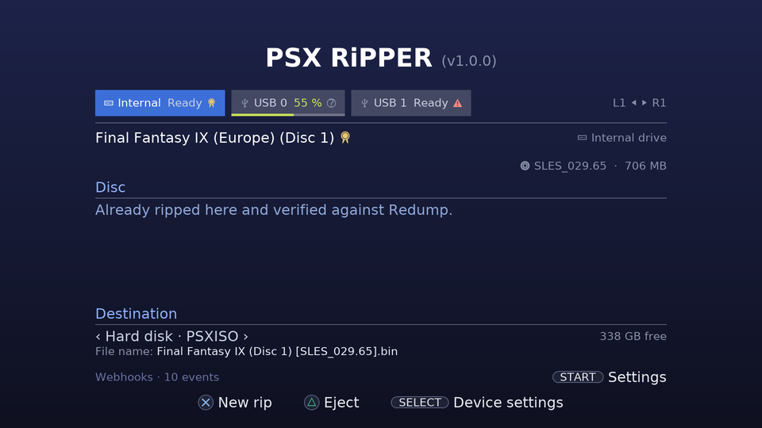

# User guide

This guide walks through PSX RiPPER from installing it to playing your rips. For every setting
and file see [configuration](configuration.md); for questions see the [FAQ](faq.md).

- [Before you start](#before-you-start)
- [Installing](#installing)
- [The screen](#the-screen)
- [Ripping a disc](#ripping-a-disc)
- [After a rip](#after-a-rip)
- [Damaged discs and Repair](#damaged-discs-and-repair)
- [Checking an earlier rip against Redump](#checking-an-earlier-rip-against-redump)
- [Several drives at once](#several-drives-at-once)
- [Where the rips go](#where-the-rips-go)
- [Settings](#settings)
- [Remote view and webhooks](#remote-view-and-webhooks)
- [Playing your rips](#playing-your-rips)
- [Logs](#logs)

## Before you start

You need a PS3 with custom firmware and Cobra (developed on **Evilnat 4.93**), with PS3MAPI.
webMAN MOD is recommended: PSX RiPPER uses it to unmount a mounted image before reading and to
refresh the game list when you exit.

Optional: one or two **Apple USB SuperDrives** (model A1379, USB ID 05AC:1500) to rip up to three
discs at the same time. They run on the PS3's USB power; no Y-cable is needed.

## Installing

1. Download `psxripper-<version>.pkg` from the [releases](https://github.com/bjornwiberg/psx-ripper/releases/latest).
2. Copy it to the PS3: a USB stick, FTP, or webMAN's *Install PKG*.
3. Install it with *Package Manager → Install Package Files* and start **PSX RiPPER** from the
   Game column. Installing a newer version over an older one keeps your settings.

## The screen

Every drive has a **tab**: *Internal* (the PS3's drive), and *USB 0* / *USB 1* for SuperDrives,
named after the USB port. **L1 / R1** (or up / down) move between the tabs. The tab shows the
drive's state (Empty, Reading, Ready, a percentage while it rips, Done) and an icon for the disc
or the last rip:

| Icon | Meaning |
|---|---|
| 🏅 medal | The rip matches Redump: it is bit-perfect |
| ⚠ warning | The rip does not match Redump, or it has sectors that could not be read |
| ? question mark | Not checked against Redump (yet) |

The page under the tabs shows, for the drive you are on:

- **The disc**: its name (Redump's name when known, else the title from the built-in list), the
  serial and size, and on the right the drive.
- **Disc**: whether it is already ripped to the destination, how that rip stands (verified,
  does not match, not checked, known errors) and what you can do about it.
- **Destination**: where the rip goes, the free space, and the file name.

The bottom row lists the buttons for this tab. Above it, START opens the settings and ○ exits
(only when nothing is ripping).

## Ripping a disc

1. Insert the disc. The tab says *Reading*, then *Ready* with the disc's name.
2. Press **✕ Rip**. With *Rip immediately when a disc is inserted* on, this happens by itself.
3. The page shows the progress: the bar, what the app does, the percentage and the time left,
   and the **events**: sectors that were hard to read and what happened to them.

A full disc takes about four minutes on the internal drive and longer on a SuperDrive. The rip
goes through up to three steps:

| Step | What happens |
|---|---|
| Reading | The whole disc, every data sector checked against its checksum (EDC/ECC) |
| Double-checking sectors without a checksum | Video and sound sectors have no checksum, so they are read once more and compared; a sector that differs is read until three reads agree |
| Re-reading uncertain sectors slowly | Sectors that could not be read are tried again at low speed with the drive's own retries |

**□ Skip re-reads** ends the slow re-reads and keeps the rip as it is; you can repair it later.
**○ Cancel rip** stops the rip; an earlier rip of the same disc stays untouched.

With *Eject the disc when done* on, the disc comes out when the rip is finished.

## After a rip

The tab says *Done* and keeps a line about the last rip, even after the disc is ejected:

> Last rip, Final Fantasy IX (Europe) (Disc 1) (SLES_029.65): Done · 4:12
> 🏅 Matches Redump

A rip that **matches Redump** is bit-perfect: every track's MD5 equals the reference. One that
**does not match** has unreadable sectors (see below), or the disc is a burned copy or a version
Redump does not list; see the [FAQ](faq.md#why-does-my-rip-not-match-redump). **Not checked**
means Redump was off or knows no such disc.

## Damaged discs and Repair

Scratches can make sectors unreadable. The rip still finishes; the sectors that could not be
read are written into the rip's log (`<name>.log`) and the tab shows the warning icon and
*Known errors: n sectors*.

1. Clean the disc.
2. Insert it again and press **□ Repair**. With automatic start on, inserting it starts the
   repair by itself.
3. Repair reads only the listed sectors, writes the ones it gets into the image and checks the
   result against Redump again. It never makes the rip worse.

You can repeat this as often as you like, for example with another drive. **✕ New rip** rips
the whole disc again instead.

## Checking an earlier rip against Redump

A rip made with Redump off, or with an older version, shows *not checked against Redump*.
**□ Check against Redump** computes the MD5s from the file on the hard disk (the disc is not
read) and writes the result into the rip's log.

## Several drives at once

Connect one or two SuperDrives (each on its own USB port); a tab appears for each. Every drive
rips on its own: insert three discs and press ✕ on each tab, or let automatic start do it. Each
tab keeps its own progress, events and result.

**SELECT Device settings** gives one drive its own settings (speed, re-reads, sector check,
eject, automatic start) instead of the standard from START; **△ All standard** puts it back.

A SuperDrive that stops answering shows *No answer*. Press **△ Eject**, or unplug its USB cable
and plug it in again.

## Where the rips go

The default is `/dev_hdd0/PSXISO/` on the internal hard disk, where webMAN finds PS1 games.
**← →** on a tab switches its destination between the hard disk and connected USB drives
(FAT32 or exFAT); the choice is remembered per drive. A disc already ripped to the destination
is recognized by its serial, also under another file name.

Each rip writes:

| File | Content |
|---|---|
| `<name>.bin` / `.cue` | The image: every track, raw 2352-byte sectors |
| `<name>.md5` | MD5 of every track |
| `<name>.log` | The rip log: tracks, MD5s, Redump result, unreadable sectors (used by Repair) |
| `/dev_hdd0/tmp/sbi/<SERIAL>.sbi` | LibCrypt data, only for the PAL discs that use LibCrypt |

The file name follows the *File name* setting; the default is `%T [%D]`, for example
`Final Fantasy IX (Disc 1) [SLES_029.65]`. webMAN hides the part in brackets in its list.

## Settings

START opens the settings. ↑↓ select, ← → change (saved at once), ✕ opens a sub-view, △ resets
everything, ○ goes back.

| Setting | What it does |
|---|---|
| Read speed | Max, 8×, 4× or 2×. Max is right for most discs |
| Re-reads on read errors | How often the drive retries a hard sector in the slow pass |
| Sector check | *Bit-perfect* (default): checksums, double-check of sectors without one, slow re-reads. *Check and re-read*: without the double-check. *Off*: read once |
| Eject the disc when done | Eject after a rip or repair |
| Rip immediately when a disc is inserted | Start by itself: a rip for a new disc, a repair for one already ripped with known errors; never overwrites a rip |
| File name | ← → picks a pattern, ✕ edits your own with `%T` title, `%R` region, `%D` disc ID, `%N` Redump's full name |
| Check against Redump | *Off*, *Online* (looks the disc up on redump.org) or *Local copy* (no internet needed) |
| Local Redump copy | ✕ downloads Redump's PlayStation list (about 4 MB) for the local mode |
| Remote view | The web page on port 8090 (see below) |
| Webhooks | ✕ opens the address, headers, events and a test |
| About PSX RiPPER | The version, who made it, the source and the libraries |

## Remote view and webhooks

With **Remote view** on, open `http://<the PS3's address>:8090/` on a computer or phone on the
same network. It shows the app's screen and, under it, a pad: its buttons press the console's,
so you can switch tabs or start a rip from the sofa. `/status.json` gives the state of every
drive for scripts. The page has no password: keep it on your home network.

**Webhooks** send an HTTP POST with a JSON body when something happens (a disc identified, a rip
started, progress, finished, failed, a repair finished, the disc ejected, the app started), for
example to a Home Assistant automation that sends a notification to your phone. See
[configuration](configuration.md#remote-view-and-webhooks) for the payload.

## Playing your rips

Mount the `.cue` with webMAN (the game list, or `/mount.ps3/dev_hdd0/PSXISO/<name>.cue`) and
start it from the XMB. Cobra applies the `.sbi` of LibCrypt discs by itself.

## Logs

- `/dev_hdd0/tmp/psxrip.log`: what the app did, for bug reports (remove webhook addresses and
  headers before you share it).
- `<name>.log` next to each rip: that rip's tracks, MD5s, Redump result and unreadable sectors.
